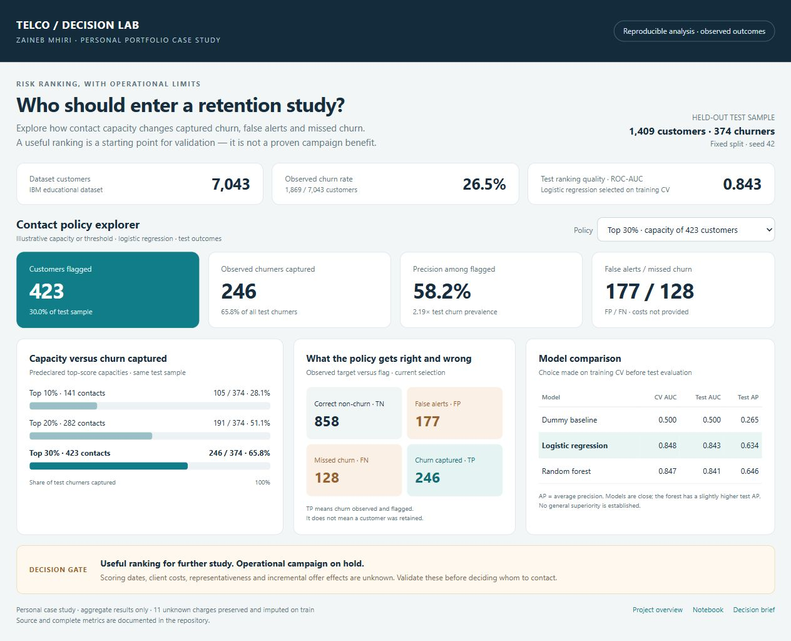

# Telco Churn — risk ranking, responsible decisions

**Zaineb Mhiri · personal portfolio case study**

[Français](README.fr.md) · [Executed notebook (French)](notebooks/telco_churn.ipynb) · [Decision brief](reports/business_summary.md) · [Methodology](docs/methodology.md)

How can a retention team examine which customers to prioritize when contact capacity is limited? This study combines data-quality checks, reproducible models and an interactive dashboard to make the trade-off between captured churn, false alerts and missed churn visible.

**Main finding:** risk ranking is informative on this educational dataset. A real campaign requires a defined client decision, scoring dates, error costs and evidence that an offer creates incremental retention.



## What is demonstrated

- **Data quality:** source verification, missing-value diagnosis, unique-customer checks and preservation of all observations.
- **Reproducible analysis:** preprocessing learned on training data, stratified splits, fixed parameters and model comparisons.
- **Decision communication:** thresholds translated into workload and FP/FN errors, with conditions for proceeding or stopping.
- **Clear deliverables:** executed notebook, aggregate metrics, interactive dashboard and concise decision brief.

This is a personal learning case study, not a delivered client engagement. The project was refined with assisted technical review for reproducibility and presentation. It does not claim a production deployment, revenue gain or independent professional certification.

## Business framing: Gate 0 and data feasibility

The illustrative stakeholder is a CRM / retention team. The question is whether scores could help study a constrained contact strategy. There is no actual client brief, validated budget or known offer effect.

| Decision input | Evidence or limitation |
|---|---|
| Decision / decision-maker | Illustrative contact prioritization; real owner to confirm |
| Error costs and acceptable risks | Unknown; false alerts are not assumed cheap |
| Capacity | Predeclared examples: top 10%, 20%, 30% |
| Scoring date / prediction horizon | Not established in the supplied data |
| Data sufficiency | Enough for an educational benchmark; insufficient for an operational campaign decision |
| Recommendation | Hold deployment; validate the client framing, timing, costs and incremental effect first |

The analysis protects against preprocessing leakage. It cannot certify that every variable was available before churn, or that this dataset represents a future client population.

## Data and protocol

[IBM Telco Customer Churn](https://github.com/IBM/telco-customer-churn-on-icp4d), retrieved from a fixed source commit and verified by SHA-256. The raw CSV is downloaded locally and excluded from Git. See [data provenance and column definitions](data/README.md).

- **7,043 customers**, 21 columns; **1,869 observed churners (26.5%)**.
- **11 unknown TotalCharges values**, all at tenure = 0. Customers are retained; imputation is learned inside each training pipeline.
- Seed 42; **4,225 train / 1,409 validation / 1,409 test**. EDA uses train only.
- Dummy baseline, standardized logistic regression and Random Forest; five-fold CV on train.
- Model selection by training CV ROC-AUC. The capacity threshold is fixed on validation before test evaluation.

## Measured results

| Model | Train CV AUC | Test ROC-AUC | Test average precision | Test accuracy |
|---|---:|---:|---:|---:|
| Dummy baseline | 0.500 | 0.500 | 0.265 | 0.735 |
| Logistic regression | 0.848 | 0.843 | 0.634 | 0.801 |
| Random Forest | 0.847 | 0.841 | 0.646 | 0.792 |

Logistic regression is selected by the predefined CV criterion. The two models are close; Random Forest has a slightly higher test average precision. No general superiority or definitive performance ceiling is established.

### Scores become workloads

On the **1,409-customer held-out test**, the top **30%** ranking selects **423 customers**, including **246 observed churners**: precision **58.2%**, recall **65.8%**. The top **10%** selects 141 customers, including 105 churners: precision 74.5%, recall 28.1%.

| Logistic policy | Flagged | TP | FP | FN | Recall |
|---|---:|---:|---:|---:|---:|
| Threshold 0.5 | 316 | 205 | 111 | 169 | 54.8% |
| Threshold 0.4, illustrative | 435 | 250 | 185 | 124 | 66.8% |
| Validation-fixed threshold 0.3849 | 452 | 256 | 196 | 118 | 68.4% |

The threshold intended to flag about 30% of validation flags **32.1% of test**. A fixed threshold does not guarantee a fixed capacity. Top-k provides an explicit count, subject to eligibility.

**A true positive is observed churn correctly flagged, not a retained customer.** Without costs and intervention effects, these figures cannot establish campaign profitability.

## Dashboard

[Open the interactive dashboard](https://zinoubjed.github.io/telco-churn-portfolio/dashboard/) · [Dashboard source](dashboard/index.html) · [Screenshot](figures/dashboard_capture.jpg)

Download the repository and open `dashboard/index.html` in your browser. It works offline, uses aggregate results only, and lets you switch among six policies. Contacts, precision, recall and the confusion matrix update together. GitHub displays the source file; it does not run the HTML page in the repository view.

To regenerate its data after rerunning the analysis:

```bash
python scripts/build_dashboard_data.py
```

## Reproduce the analysis

Validated with **Python 3.10** in a separate environment:

```bash
python -m venv .venv
# Windows PowerShell:
.venv\Scripts\Activate.ps1
# macOS / Linux:
# source .venv/bin/activate
python -m pip install -r requirements.txt
python -m src.analysis
python -m unittest discover -s tests -v
python scripts/execute_notebook.py
python scripts/build_dashboard_data.py
```

The first run needs network access to retrieve the pinned IBM CSV. A cached file must match the documented checksum. `requirements.txt` pins direct dependencies; `requirements-lock.txt` records the complete tested Windows/Python 3.10 environment. Runtime versions are recorded in `reports/summary.json`.

## Interpretation and limits

Contract and tenure show associations, not causal effects. Coefficients depend on coding, regularization and correlated variables. Calibration and Brier are diagnostics; the AUC bootstrap interval of about **[0.821, 0.864]** is conditional on a fixed model, not a future guarantee.

There is no temporal/external validation, measured retention uplift, demonstrated ROI or exhaustive fairness audit. A high-risk cohort might be impossible to retain, while a moderate-risk cohort responds better to an offer. A good prediction is not necessarily a good action.

**Next decision:** validate the real client need, reconstruct variables at scoring time, reserve a future test period, compare against a simple CRM rule, and measure intervention effects with a control group.

## Files and verification

| File / folder | Purpose |
|---|---|
| `notebooks/` | Executed walkthrough: one code cell followed by an interpretation |
| `reports/` | Decision brief and aggregate result exports |
| `dashboard/` | Offline interactive policy explorer |
| `figures/` | Dashboard screenshot and analytical figures |
| `data/README.md` | Provenance, variables and cleaning rules |
| `src/`, `scripts/`, `tests/` | Shared computation, execution and targeted checks |

Verified: complete notebook execution, three targeted tests, source checksum, report consistency and dashboard interactions. Publication is a presentation of this case study, not automatic validation of professional proficiency.
